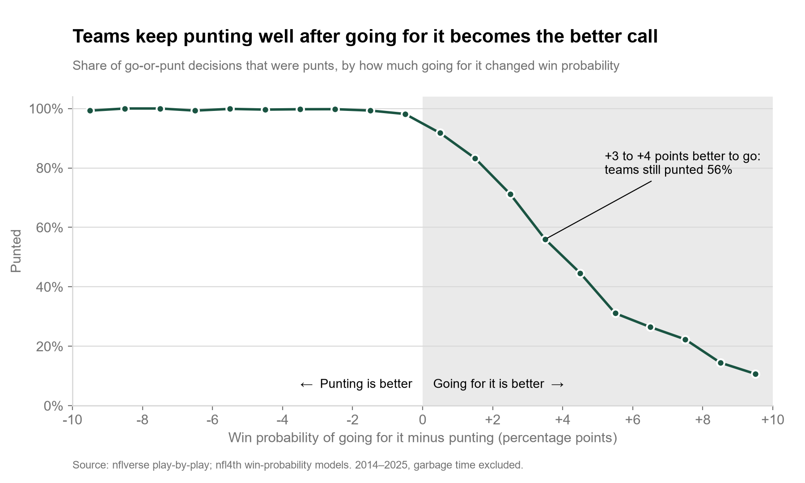

# Decision memo: NFL fourth-down punting

**To:** Head coach and director of football analytics, any NFL club
**Analysis window:** regular season and postseason, 2014 to 2025
**Data as of:** 2026-10-04
**Source:** nflverse play-by-play joined to nfl4th's published win-probability models, 47,892 fourth-down decisions

---

## Recommendation

**On fourth and 1 or 2, from your own 21 to the opponent's 35, make going for it the default whenever the model's edge for going is 2 points of win probability or more. Punting needs a stated reason.**

Across the league, teams punted 47 percent of the time in exactly those situations. That one band accounts for **53 percent of all win probability given up** by punting when going for it was better: 38 of 72 expected wins over twelve seasons.

The league has moved a long way since 2014, and the remaining gap is concentrated enough to manage with one rule rather than a philosophy change.

---

## The question this answers

When NFL teams face fourth down, how often do they punt even though going for it has a higher modelled win probability? And is that a systematic pattern, or the noise you would expect from any model?

**Hypothesis, stated before the analysis.**
H0: after accounting for field position, yards to go, score, time remaining, timeouts and game strength, teams do not systematically punt when going for it offers greater expected win probability.
H1: teams systematically punt in some situations where going for it offers greater expected win probability.

Every control in H0 is an input to nfl4th's models (game strength enters through the pre-game point spread), so comparing the go and punt win probabilities for the same snap holds them fixed. H0 would be rejected only if three independent tests all pointed the same way.

**Verdict: H0 is rejected on all three.**

---

## Evidence

### 1. The mistakes run one way

Headline population: 25,318 go-or-punt decisions where both options are modelled, excluding garbage time (either option below 5 or above 95 percent).

| When one option was better by 2+ points | Decisions | Team chose the other option |
| --- | --- | --- |
| Going for it was better | 4,085 | **52.5%** punted anyway |
| Punting was better | 7,560 | **0.3%** went for it anyway |

If coaches followed win probability and only made random mistakes, these two rates would be similar. The difference is 52.3 points (95% CI 50.6 to 53.9, resampling whole games). At a stricter 4-point margin it is still 31.4 percent against 0.3 percent, so the result does not depend on small, uncertain edges.

Measured differently, 9.5 percent of all punts (CI 9.1 to 9.9) came when going for it was better by more than 2 points.

### 2. The situation drives the punt, not the win probability

A logistic regression of the punt decision on a flexible curve of the go advantage, plus field position, distance, score and quarter, with standard errors clustered by game. If teams decided on win probability, nothing else would matter once the advantage is known.

The situation terms are jointly significant (Wald chi-square 1,261 on 15 degrees of freedom, p < 1e-200). Field position contributes most.

| With the same +3 point edge for going for it | Predicted punt rate |
| --- | --- |
| Own 1 to 20 | 96.8% |
| Own 21 to 40 | 92.6% |
| Own 41 to midfield | 84.2% |
| Opponent 49 to 35 | 59.3% |

The win probability says the same thing in all four rows. The decision does not. Teams appear to treat their own half of the field as punting territory, whatever the numbers say.

### 3. It holds every season, and it is shrinking

| | 2014 | 2017 | 2019 | 2021 | 2023 | 2025 |
| --- | --- | --- | --- | --- | --- | --- |
| Punted when going was better by 2+ | 71% | 69% | 48% | 43% | 42% | 37% |
| Went for it when punting was better by 2+ | 0.6% | 0.7% | 0.2% | 0.0% | 0.3% | 0.2% |

The asymmetry is statistically significant in all 12 seasons. Most of the change came between 2018 and 2020. That timing coincides with public fourth-down models becoming widely used, but this analysis cannot show they caused it. Since then it has narrowed slowly. In 2025 the league still punted 138 times when going for it was better by 2 or more points.

### 4. Where the cost is

| Situation | Times going was better by 2+ | Punted | Expected wins forfeited |
| --- | --- | --- | --- |
| 4th and 1, own 21 to 40 | 668 | 485 (73%) | **16.1** |
| 4th and 1, own 41 to midfield | 436 | 192 (44%) | 7.5 |
| 4th and 4 to 5, opponent 49 to 35 | 331 | 183 (55%) | 6.0 |
| 4th and 6 to 9, opponent 49 to 35 | 247 | 180 (73%) | 5.5 |
| 4th and 2, own 21 to 40 | 173 | 158 (91%) | 5.1 |
| 4th and 2, own 41 to midfield | 148 | 113 (76%) | 3.9 |

These six situations hold 61 percent of the total. The first row alone is 22 percent.

Across the league the total is 72 expected wins over 12 seasons at the 2-point margin, or **0.19 wins per team per season**. Counting every positive edge, however small, it is 0.32. These are expected wins in the model, not observed wins.

---

## Recommendations

### R1. Go for it by default on 4th and 1 to 2, own 21 to opponent 35, when the edge is 2+ points

This is the band that carries half the cost and where teams still punt about half the time. A default works better than case-by-case judgement here: on the sideline, punting is the choice that never needs defending.

**How:** before each game, the analytics staff prepares the nfl4th recommendations for this band given the spread and expected conditions. On the day, the default is to go; punting requires a stated reason, such as an injury at a key position, a specific matchup, or weather. Logging those reasons builds the evidence for R4.

For context, teams that did go for it on fourth and 1 in their own 21 to midfield converted 71.5 percent of 822 attempts in this period. That rate comes from attempts teams chose to make, so it is optimistic for the attempts they declined (see limitation 2).

### R2. Review the opponent 49 to 35 at 4 to 9 yards separately

This is the second concentration, at 11.5 expected wins. It is outside reliable field-goal range, and a punt from there nets little field position. It is a different decision from R1 because the conversion odds are lower. It needs its own review, not the same default.

### R3. Do not chase small edges

Below 2 points, the gap between options is inside plausible model error. At zero margin, a third of all punts would count as mistakes, which would overstate the problem and invite overcorrection. Keep the 2-point threshold.

### R4. Do not benchmark against individual clubs yet

For 2023 to 2025, team punt rates in clearly-go situations range from 23 to 64 percent. At 22 to 45 relevant snaps per team, that spread is not distinguishable from chance (chi-square p = 0.061). Ranking clubs from it would reward luck. The pattern is league-wide.

---

## Measuring whether R1 worked

**Primary measure:** among your club's decisions where going for it was better by 2+ points, the share that were punts, in R1's band and in total. In 2025 the league figure was 37 percent overall.

**Why not wins:** the effect is about 0.19 expected wins per season. That is far too small to detect in a 17-game win-loss record, which would credit or blame the policy for noise. Measure the decision, which the club controls, not the outcome.

**Model check:** record the conversion result of every R1 attempt. After a season, compare actual conversions with nfl4th's predicted first-down probability for the same snaps. If teams convert less often than the model predicts in this band, that is evidence for limitation 2 and the threshold should rise. The precomputed file used here does not include the conversion probability, so this check needs nfl4th run directly.

**Definitions are fixed.** `src/definitions.py` sets the decision coding, the margin and the garbage-time rule, so a follow-up measurement computes the same thing.

---

## Limitations

1. **Every finding is relative to nfl4th's models.** If the models are miscalibrated in a situation, the gap there is wrong by the same amount.

2. **The asymmetry has two readings.** Coaches may be too conservative. Or they may correctly believe the conversion model is too optimistic for the attempts they decline, because it is trained on attempts teams chose to make, which are plausibly easier. This data cannot separate the two. That the gap persists at a 4-point margin makes pure model error less likely, and the model check above is how to resolve it.

3. **Coaches know things the model does not:** injuries, weather beyond the basic fields, matchups, and what the next drive is likely to look like.

4. **Win probability is not the only objective.** Job security and the uneven blame for a failed attempt compared with a punt are real incentives. This analysis measures the gap, not the motive.

5. **Overtime is excluded.** nfl4th does not compute probabilities for it, or for the final seconds of a half (1.3 percent of decisions).

6. **Inside the opponent's 35 the comparison does not apply.** nfl4th does not model a punt there, and field goals dominate. Only 5 actual punts were lost to this.

7. **Garbage time is excluded from the headline.** It removes 18 percent of punts. Including it lowers the headline share from 9.5 to 7.9 percent, and does not change the direction of any result.

8. **Observational data, no causal claims.** The analysis shows what teams did against what the model recommended. It cannot show what would have happened had they chosen differently.

---

## Reproducibility

Every figure traces to `reports/analysis_tables__2026-10-04.md`. That file is produced from an analysis table built and tested in `src/model.py` (8 tests, including reconciliation to the validation counts), from a snapshot recorded with source URLs, release timestamps and SHA-256 hashes. Decision coding was checked against nflfastR's independent `series_result` field: 98.7 percent of coded punts end in a punt, and the rest are return touchdowns, blocks and accepted penalties.

Confidence intervals resample whole games, 2,000 times, with a fixed seed. Two consecutive runs produce identical output.
